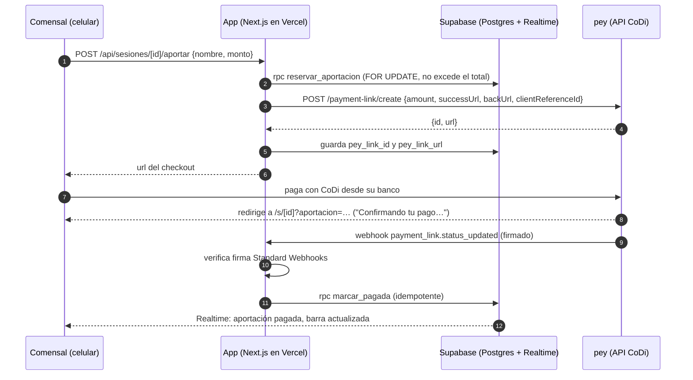

# pey-split

**Divide la cuenta del restaurante con un solo QR y que cada quien pague su parte con CoDi.**

Prototipo para el hackatón de pey / CoDi. El restaurante crea la cuenta (por ejemplo, $1,200) y muestra un QR en la mesa. Cada comensal lo escanea, aparta lo que va a pagar y paga con CoDi desde la app de su banco. Todos ven la barra llegar al 100% en tiempo real.

**Estado:** prototipo funcional, desplegado en Vercel y probado de punta a punta con cobros reales de $0.01.

**Demo (modo simulado, sin dinero real):** https://pey-split-tau.vercel.app. Ver [cómo probarla](#probar-la-demo).

> ⚠️ Con `PEY_MODE=real` cada pago mueve dinero de verdad. Para demos públicas usa `PEY_MODE=simulado`.

---

## Cómo funciona

| Pantalla | Ruta | Quién la usa |
|---|---|---|
| Crear cuenta | `/` | El restaurante: nombre de la mesa y total |
| Caja | `/s/[id]/caja` | El restaurante: QR grande, barra en vivo y lista de aportaciones |
| Lobby | `/s/[id]` | El comensal: aparta su parte y paga |
| Pago simulado | `/simular/[linkId]` | Solo en `PEY_MODE=simulado`: imita el checkout de pey |

### El comensal
1. Escanea el QR y abre el lobby.
2. Escribe su nombre y el monto. Puede usar dos atajos:
   - **"Todo lo que falta"**
   - **"Partes iguales"**, de 2 a 8 personas. Divide el total y redondea hacia arriba al centavo para que la suma nunca quede corta.
3. Al tocar **"Pagar con CoDi"**, la app **aparta** ese monto por 7 minutos y crea un **link de pago de pey**. El comensal paga en el checkout de pey con la app de su banco.
4. pey lo regresa al lobby y aparece "Confirmando tu pago…". Cuando llega el webhook de pey, cambia solo a "¡Gracias!".
5. Al completar el total, la caja y todos los celulares muestran **"¡Cuenta liquidada!"**.

### Probar la demo

La demo pública corre en **modo simulado**: no se cobra nada y el "checkout" es una página de la app con un botón para confirmar el pago.

**Con dos o más dispositivos** (lo ideal)
1. En una laptop o tablet abre https://pey-split-tau.vercel.app y crea una cuenta, por ejemplo "Mesa 4" por $600. Se abre la **vista de caja** con el QR.
2. Escanea el QR con un celular. En el lobby escribe un nombre, toca **"Partes iguales: 3"** ($200) y luego **"Pagar $200.00 con CoDi"**.
3. En la página **"Pago simulado · sin dinero real"** toca **"Pagar $200.00 (simulado)"**. Regresas al lobby con **"¡Gracias!"**, y la caja sube a 33% sin recargar.
4. Repite con otros celulares, o desde el mismo con **"Pagar otra parte"**, hasta completar el total. Todas las pantallas muestran **"¡Cuenta liquidada!"**.

**Con una sola computadora**
Abre la caja en una pestaña y el link que aparece debajo del QR en otra; es el lobby. Paga desde la pestaña del lobby y mira la caja actualizarse sola.

**Qué más puedes probar**
- **"Cancelar y volver"** en el pago simulado: el lobby muestra "Tu pago está pendiente", el tiempo restante y "Volver al pago".
- **Dos personas a la vez:** desde dos celulares, toca "Todo lo que falta" en ambos y paga casi al mismo tiempo. El segundo recibe "Alguien se adelantó: solo quedan $X" y su monto se ajusta.
- **Reserva vencida:** aparta un monto y no pagues. A los 7 minutos aparece como "Venció" y el monto vuelve a estar disponible.

> Lo que escribas en la demo es visible para cualquiera y puede borrarse en cualquier momento. No uses datos personales reales.

### Reglas que garantiza la base de datos
- **Nunca se aparta más de lo que falta.** Si dos comensales intentan apartar a la vez, el segundo recibe "Alguien se adelantó: solo quedan $X" y su monto se ajusta.
- **Un pago no se cuenta dos veces**, aunque pey reenvíe el mismo webhook.
- **Las reservas sin pagar vencen** a los 7 minutos y liberan su monto.
- **Un pago tardío se registra igual.** Si llega después de que venció la reserva, se acepta porque el dinero ya entró.

---

## Flujo técnico



---

## Stack

| Capa | Tecnología |
|---|---|
| Frontend y API | [Next.js 16](https://nextjs.org) (App Router, Cache Components, Turbopack), React 19, TypeScript |
| Estilos | Tailwind CSS 4, con tokens de color para modo claro y oscuro |
| Base de datos | [Supabase](https://supabase.com): Postgres con funciones PL/pgSQL, RLS y Realtime |
| Pagos | [pey](https://docs.pey.mx): links de pago CoDi y webhooks firmados ([Standard Webhooks](https://www.standardwebhooks.com)) |
| QR | [`qrcode`](https://www.npmjs.com/package/qrcode), generado en el servidor como SVG |
| Hosting | [Vercel](https://vercel.com) |
| Pruebas | [Vitest](https://vitest.dev) y un script de punta a punta en Python contra Supabase |

---

## Arquitectura

```
app/
  page.tsx                      Crear cuenta
  s/[id]/page.tsx               Lobby del comensal
  s/[id]/caja/page.tsx          Vista de caja (QR + progreso)
  simular/[linkId]/page.tsx     Checkout simulado
  api/sesiones/                 POST crear cuenta
  api/sesiones/[id]/aportar/    POST apartar y crear link de pago
  api/webhooks/pey/             POST webhook de pey
  api/simular/[linkId]/         POST confirmar pago simulado
components/                     Vistas de caja y lobby, formulario, barra, lista
lib/
  cuentas.ts                    Lógica: crear sesión, aportar, registrar pago
  consultas.ts                  Lectura de la cuenta para las páginas
  pey/                          Adaptador de pey: simulado | real
    real.ts                     API de producción de pey
    simulado.ts                 Sin dinero real
    firma.ts                    Verificación de firma del webhook
    evento.ts                   Lectura del webhook → pago en centavos
  supabase/admin.ts             Cliente con clave secreta (solo servidor)
  supabase/navegador.ts         Cliente con clave publishable (lectura + Realtime)
  use-cuenta-en-vivo.ts         Hook: Realtime + consulta de respaldo cada 15 s
  resumen.ts, sugerencias.ts    Cálculos de la vista (porcentajes, parte igual)
  validacion.ts                 Validación de montos y textos
supabase/
  migrations/                   Esquema, funciones, RLS, Realtime y permisos
  pruebas/                      Pruebas SQL (terminan en ROLLBACK)
test/                           Vitest y la prueba de punta a punta
docs/                           Ejemplos reales de webhooks de pey (datos tapados)
```

### Base de datos
- **`sesiones`**: la cuenta (`total_centavos`, `pagado_centavos`, `estado`: `abierta` | `liquidada`).
- **`aportaciones`**: la parte de cada comensal.
  - Guarda el nombre de pila, `monto_centavos`, `estado` (`reservada` | `pagada` | `expirada`) y `expira_at`.
  - También guarda los datos del cobro en pey: `pey_link_id`, `pey_link_url` y `pey_transaction_id`.
- **`reservar_aportacion()`**: bloquea la sesión con `FOR UPDATE`, libera las reservas vencidas y rechaza montos que excedan lo disponible (`excede_total`).
- **`marcar_pagada()`**: busca la aportación por `pey_link_id`. Si ya estaba pagada, no hace nada. Suma el pago a la sesión y la liquida al llegar al total.
- **Permisos:** el navegador (rol `anon`) solo puede **leer**. Todas las escrituras pasan por el servidor con la clave secreta.
- Los montos se guardan **en centavos** (enteros). pey usa pesos con decimales y la conversión se hace en el adaptador.

### pey
- **Cobro:** se usan **links de pago** (`POST /payment-link/create`). Un link no se puede pagar dos veces, pero tampoco vence.
- **Webhook:** pey avisa con `payment_link.status_updated`, y solo se procesa cuando `status` es `paid`. El monto se toma de `transactions[].amountBreakdown.base`.
- **Firma:** se verifica sobre el cuerpo crudo con HMAC-SHA256 y una tolerancia de 5 minutos.
- **Configuración del webhook:** pey permite un webhook por API key, y su URL no se puede editar en el portal. Para cambiarla hay que crear otra API key.
- **Formatos reales:** en [`docs/`](docs/) hay ejemplos de webhooks reales con los datos tapados.

---

## Correr en local

Requisitos: Node 24 y un proyecto de Supabase.

```bash
npm install
cp .env.example .env   # y llenar los valores
```

1. **Base de datos:** en Supabase, abre el SQL Editor y corre en orden `supabase/migrations/0001_init.sql` y `0002_permisos.sql`. Si quieres comprobarla, corre después `supabase/pruebas/0001_pruebas.sql`.
2. **Variables** (ver [`.env.example`](.env.example)):

   | Variable | Para qué |
   |---|---|
   | `APP_URL` | URL pública, sin `/` final. En local: `http://localhost:3000` |
   | `NEXT_PUBLIC_SUPABASE_URL`, `NEXT_PUBLIC_SUPABASE_PUBLISHABLE_KEY` | Lectura y Realtime en el navegador |
   | `SUPABASE_SECRET_KEY` | Escrituras desde el servidor |
   | `PEY_MODE` | `simulado` (sin dinero) o `real` |
   | `PEY_API_URL`, `PEY_API_KEY`, `PEY_WEBHOOK_SECRET` | Solo para `PEY_MODE=real` |

3. **Arrancar:**

   ```bash
   npm run dev
   ```

   Abre http://localhost:3000. Con `PEY_MODE=simulado` todo el flujo funciona sin dinero, porque el "checkout" es `/simular/[linkId]`.

`PEY_MODE=real` exige que `APP_URL` sea `https://`, porque pey solo acepta URLs de regreso con HTTPS. Por eso el modo real se prueba en Vercel y no en local.

## Pruebas

```bash
npm test      # Vitest: validación, firma con webhooks reales, cálculos
npm run lint
npm run build
```

La prueba de punta a punta contra Supabase crea datos reales y los borra al final. Las instrucciones de uso están al inicio de [`test/e2e/punta_a_punta.py`](test/e2e/punta_a_punta.py).

## Deploy (Vercel)

1. Importa el repo en Vercel y elige **Framework Preset: Next.js**. Si queda en "Other", el build falla buscando una carpeta `public`.
2. Carga las variables de entorno, sin `SUPABASE_DB_PASSWORD`. Después del primer deploy agrega `APP_URL` con el dominio de producción y haz Redeploy.
3. En el portal de pey (Desarrollador → engrane de la API key), crea el webhook apuntando a `https://<dominio>/api/webhooks/pey` y guarda el secreto en `PEY_WEBHOOK_SECRET`.
4. Cada cambio de variable de entorno necesita un Redeploy.

---

